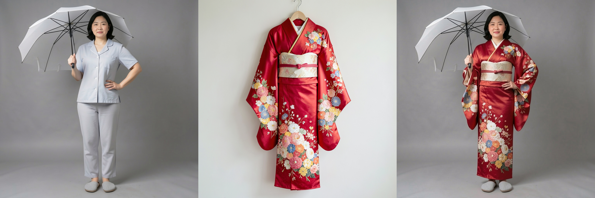
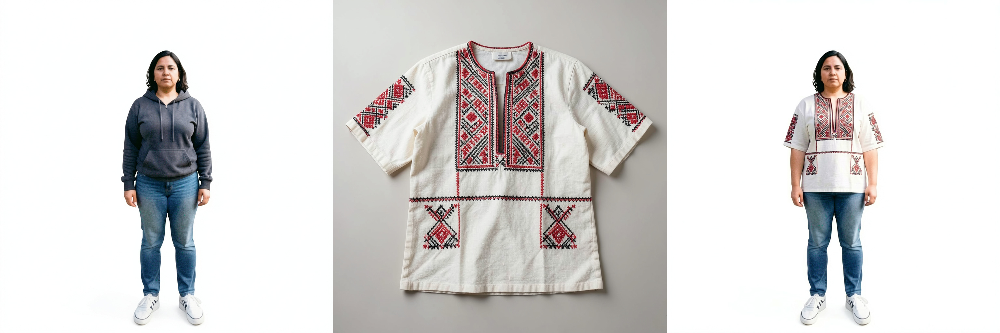
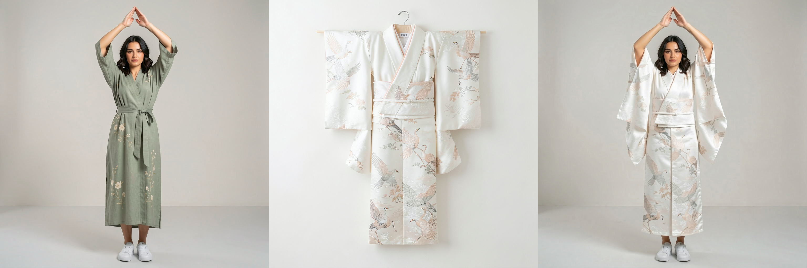
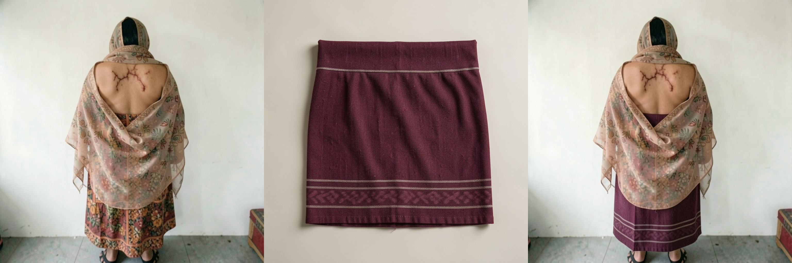

# CURVTON-205K

**A Mask-Free Difficulty-Stratified Synthetic Dataset for Robust and Scalable Virtual Try-On** · WACV 2027

[Project page](https://curvton2.github.io/curvton/) · [Dataset on Hugging Face](https://huggingface.co/datasets/curvton2/curvton2) · [Code](https://github.com/curvton2/CURVTON_205K)



*Every CURVTON-205K sample is a triplet — source person, in-shop garment, try-on result — at 1024×1024, created without cloth segmentation masks.*

---

## Contents

1. [Overview](#1-overview)
2. [Quick start](#2-quick-start)
3. [Repository structure](#3-repository-structure)
4. [The dataset](#4-the-dataset)
5. [Data generation pipeline](#5-data-generation-pipeline)
6. [Training](#6-training)
7. [Inference](#7-inference)
8. [Evaluation](#8-evaluation)
9. [Assets: prompts, dictionaries, rubric](#9-assets-prompts-dictionaries-rubric)
10. [Citation](#10-citation)

---

## 1. Overview

Virtual try-on (VTON) models still fail on difficult poses, occlusions and garments they rarely see. We argue that many of these failures come from **the training data**, not only the model architecture.

This repository contains everything behind **CURVTON-205K**:

- **A data generation pipeline** that creates try-on triplets with an image generator (FLUX.2 [klein] 9B) and checks every result with a vision-language model (Qwen3-VL-32B-Instruct), retrying with an improved prompt when a result fails.
- **Training code** for a mask-free try-on model, with curriculum (easy → hard) and non-curriculum schedules, plus the paper's ablations.
- **Evaluation code** for try-on quality (overall and per stratum) and for how diverse and difficult a dataset is.

| | CURVTON-205K |
|---|---|
| Training triplets | 205,000 |
| Test triplets | 4,500 |
| Resolution | 1024 × 1024 |
| Garment types | 200, including many traditional garments from around the world |
| Difficulty tiers | easy · medium · hard |
| Masks / parsing / dense pose needed | none |

---

## 2. Quick start

**1. Install**

```bash
git clone https://github.com/curvton2/CURVTON_205K.git
cd CURVTON-205K_CODE
python -m venv .venv && source .venv/bin/activate      # Windows: .venv\Scripts\activate
pip install -r requirements.txt                          # install the CUDA build of PyTorch first
```

More detail: [`SETUP.md`](SETUP.md).

**2. Get the data** from [Hugging Face](https://huggingface.co/datasets/curvton2/curvton2) and note the paths of the training and test folders (layout in [Section 4](#4-the-dataset)).

**3. Train**

```bash
CURVTON_DATA_PATH=/path/to/train bash CURVTON_Experiments/scripts/train_curriculum.sh
```

**4. Try it on one image**

```bash
python CURVTON_Experiments/inference.py \
    --checkpoint CURVTON_Experiments/experiments/<run_name>/checkpoints/ckpt_final.pt \
    --person person.png --cloth cloth.png --output result.png --save_grid
```

**5. Evaluate per difficulty tier**

```bash
CURVTON_ROOT=/path/to/test GENERATED_ROOT=/path/to/model_outputs MODELS="my_model" \
bash Evaluation/VTON_Evaluation/stratified/eval_difficulty.sh
```

---

## 3. Repository structure

```text
CURVTON-205K_CODE/
├── CURVTON_assets/               Inputs the pipeline reads, plus paper figures
│   ├── dictionaries/             cloth, person, garment (dress_info) and camera-angle dictionaries
│   ├── system_prompts/           VLM system prompts
│   ├── human_eval_rubrics.json   10-question rubric for manual quality labels
│   └── docs/images/              figures used in this README
│
├── CURVTON_Data_Pipeline/        Generates the dataset (Section 5)
│
├── CURVTON_Experiments/          Trains and runs try-on models (Sections 6–7)
│   ├── train.py                  training entry point
│   ├── inference.py              single-image inference
│   ├── model.py, utils.py, dataloader.py
│   └── scripts/                  ready-made training runs
│
├── Evaluation/                   Measures results (Section 8)
│   ├── VTON_Evaluation/          try-on quality: stratified/, zeroshot/, trained/
│   └── Dataset_Complexity_Metrics/   dataset diversity and difficulty (paper metrics + extras/)
│
├── requirements.txt              one requirements file for the whole repository
└── SETUP.md                      environment setup
```

---

## 4. The dataset

### Difficulty tiers

| Tier | What changes |
|---|---|
| **Easy** | Simple poses, plain or studio backgrounds, small appearance changes (body shape, lighting, accessories) |
| **Medium** | Moderate pose changes, partial occlusion, busier backgrounds, camera-view changes |
| **Hard** | Large pose changes, heavy occlusion, clutter, unusual viewpoints |





*Top to bottom: easy, medium, hard. Each row shows source person · target garment · try-on.*

### Folder layout

The training and test sets use the same layout:

```text
<root>/
└── easy/ medium/ hard/
    └── male/ female/
        ├── initial_person_image/   fh_017548_e01.png
        ├── cloth_image/            fh_017548_e01_fc_019460_dress.png
        └── tryon_image/            fh_017548_e01_fc_019460_qipao.png
```

### File names

`fh_017548_e01_fc_019460_qipao.png` reads as:

| Part | Meaning |
|---|---|
| `fh_017548` | person (`fh` = female, `mh` = male) |
| `e01` | edit number of that person |
| `fc_019460` | garment (`fc` / `mc` = female / male garment) |
| `qipao` | garment name (in `tryon_image/`) |
| `dress` | body region `upper` / `lower` / `dress` (in `cloth_image/`) |

---

## 5. Data generation pipeline

The pipeline has four streams. **FLUX.2 [klein] 9B** generates every image; **Qwen3-VL-32B-Instruct** writes prompts and checks results.

| Stream | What happens | Code |
|---|---|---|
| **1. Cloth** | Sample a garment from the cloth dictionary → LLM writes a prompt → FLUX draws the garment (~35K images) | `cloth_stream/` |
| **2. Person** | Sample body type, region, pose, accessories, background… → LLM writes a prompt → FLUX draws the person (~41K images) | `person_stream/` |
| **3. Editing** | Sample easy / medium / hard edit keywords → VLM writes an edit instruction → FLUX edits the person → VLM rejects bad edits (100K per tier) | `vton/edit/` (easy), `edit_prompt_generation/` + `shared/` (medium, hard) |
| **4. Merging** | Pair person + garment → FLUX makes the try-on → VLM compares person, garment and result; on failure it writes an improved prompt and FLUX retries (up to 4 times) | `vton/tryon/`, `vton/job_tryon_loop.sh` |

After the loop, a ViT filter trained on 5,000 hand-labelled triplets keeps the triplets that score ≥ 0.85, giving CURVTON-205K.

### Running it

All jobs are SLURM scripts for a multi-GPU cluster. Fill in the `PATH_TO_…` and `SLURM_ACCOUNT` placeholders first. The main entry points, in order (paths relative to `CURVTON_Data_Pipeline/`):

| Step | Job |
|---|---|
| Garment images | `cloth_stream/run_cloth.sh` |
| Person metadata | `person_stream/person_prompts_to_json.sh` |
| Medium / hard edit instructions | `edit_prompt_generation/job_edit_prompts.sh` |
| Easy edits (instructions, FLUX edit, VLM check) | `vton/job_edit.sh` |
| Try-on loop (generate → check → retry), camera-angle edits, final file naming | `vton/job_tryon_loop.sh` |

Other folders: `camera_angle_control/` (camera-angle editing on its own), `editing_2k_samples/` (a small editing run on two fixed subjects), `vlm_score/` (optional VLM complexity scoring).

---

## 6. Training

The model is Stable Diffusion 1.5 with the person and garment images placed side by side as the condition. No masks or text prompts are used. All runs go through `CURVTON_Experiments/train.py` via the scripts in `CURVTON_Experiments/scripts/`.

### Main settings

```bash
# Curriculum: start with easy samples, then gradually add medium and hard
CURVTON_DATA_PATH=/path/to/train bash CURVTON_Experiments/scripts/train_curriculum.sh

# Non-curriculum baseline: sample all tiers uniformly for the whole run
CURVTON_DATA_PATH=/path/to/train bash CURVTON_Experiments/scripts/train_non_curriculum.sh
```

### Ablations

| Script | Trains on |
|---|---|
| `train_easy_only.sh` · `train_medium_only.sh` · `train_hard_only.sh` | a single tier |
| `train_easy_medium.sh` · `train_easy_hard.sh` · `train_medium_hard.sh` | two tiers |
| `train_data_percent.sh` with `PERCENT=10` (20, 50, 100 …) | a random share of all three tiers |

```bash
CURVTON_DATA_PATH=/path/to/train bash CURVTON_Experiments/scripts/train_hard_only.sh
PERCENT=20 CURVTON_DATA_PATH=/path/to/train bash CURVTON_Experiments/scripts/train_data_percent.sh
```

### Options

Set these as environment variables before the script:

| Variable | Meaning | Default |
|---|---|---|
| `CURVTON_DATA_PATH` | training set root | required |
| `CURVTON_TEST_DATA_PATH` | test set root, for evaluation during training | none |
| `NPROC` | number of GPUs | `4` |
| `CURRICULUM` | `hard`, `soft`, `reverse`, `soft_reverse` (curriculum script) | `soft` |
| `DIFFICULTY` | `all`, `easy`, `medium`, `hard`, `easy_medium`, `easy_hard`, `medium_hard` | `all` |
| `DATA_PERCENT` | share of the training data to use | `100` |
| `MAX_STEPS`, `BATCH_SIZE`, `LR` | training length, batch size per GPU, learning rate | `30000`, `32`, `1e-4` |

Any extra arguments are passed to `train.py`, e.g. `bash scripts/train_curriculum.sh --use_dream`.

Checkpoints are saved to `CURVTON_Experiments/experiments/<run_name>/checkpoints/`; change the location with `--output_dir`. A run that is restarted resumes from its latest checkpoint.

---

## 7. Inference

```bash
python CURVTON_Experiments/inference.py \
    --checkpoint path/to/ckpt.pt \
    --person person.png \
    --cloth cloth.png \
    --output result.png \
    --save_grid
```

| Flag | Meaning | Default |
|---|---|---|
| `--steps` | denoising steps | `50` |
| `--size` | square image size (≤ 0 keeps the original size) | `512` |
| `--seed` | random seed | `42` |
| `--save_grid` | also save person · garment · try-on side by side | off |
| `--ootd` | for checkpoints trained with `--ootd` (garment-only conditioning) | off |

---

## 8. Evaluation

### Try-on quality — `Evaluation/VTON_Evaluation/`

Metrics: SSIM, PSNR, LPIPS, FID, KID.

| Folder | Use it to |
|---|---|
| `stratified/` | score a model **per difficulty**, **per body region** (upper / lower / dresses) and **traditional vs non-traditional** garments |
| `zeroshot/` | score any model's saved outputs against the test set |
| `trained/` | score a checkpoint trained with `CURVTON_Experiments/` |

Stratified evaluation:

```bash
export CURVTON_ROOT=/path/to/test
export GENERATED_ROOT=/path/to/model_outputs      # <model>/<stratum>/<male|female>/tryon_image/
export MODELS="catvton idmvton"

bash Evaluation/VTON_Evaluation/stratified/eval_difficulty.sh      # easy / medium / hard / overall
bash Evaluation/VTON_Evaluation/stratified/eval_body_region.sh     # upper_body / lower_body / dresses
bash Evaluation/VTON_Evaluation/stratified/eval_traditionality.sh  # traditional / non_traditional
```

The test set is already split by difficulty. The body-region and traditionality splits are built automatically from the file names and `dress_info.json`. See [`stratified/README.md`](Evaluation/VTON_Evaluation/stratified/README.md).

Trained checkpoint:

```bash
python Evaluation/VTON_Evaluation/trained/unified_eval.py --target base -- --help
```

### Dataset complexity — `Evaluation/Dataset_Complexity_Metrics/`

This measures how varied a dataset is. `compute_metrics.py` computes the paper's diversity table — pose (σ²_pose, via `pose_diversity.py`), occlusion, background, illumination, body shape, garment and camera — for CURVTON tiers or a benchmark dataset:

```bash
cd Evaluation/Dataset_Complexity_Metrics
python compute_metrics.py --curvton_root /path/to/test --output results/curvton.json
```

Metrics not reported in the paper (appearance, VAE latent, a unified index and secondary outputs) are in `extras/`. See [its README](Evaluation/Dataset_Complexity_Metrics/README.md).

---

## 9. Assets: prompts, dictionaries, rubric

Everything the pipeline reads lives in [`CURVTON_assets/`](CURVTON_assets/README.md).

| File | Purpose |
|---|---|
| `dictionaries/cloth_dictionary.json` | garments sampled by the cloth stream |
| `dictionaries/person_dictionary.json` | body types, poses, regions, gender, with sampling probabilities |
| `dictionaries/dress_info.json` | 385 garment entries: name, type, structural description, traditional or not |
| `dictionaries/camera_control.json` | camera-angle edit prompts per tier |
| `system_prompts/medium_hard_person_edit_prompt.txt` | VLM: edit keywords → edit instruction (as in the paper) |
| `system_prompts/edited_person_qc_prompt.txt` | VLM: accept / reject an edited person (as in the paper) |
| `system_prompts/tryon_feedback_prompt.txt` | VLM: judge a try-on and write an improved prompt (as in the paper) |
| `system_prompts/easy_edit_system_prompt.txt` | VLM: easy-tier edit instruction |
| `system_prompts/person_prompt_to_json_system_prompt.txt` | VLM: person description → structured metadata |
| `human_eval_rubrics.json` | 10 questions used to hand-label triplet quality |

---

## 10. Citation

If you use CURVTON-205K or this code, please cite:

```bibtex
@inproceedings{bartaula2027curvton,
  title     = {CURVTON-205K: A Mask-Free Difficulty-Stratified Synthetic Dataset for Robust and Scalable Virtual Try-On},
  author    = {Bartaula, Dipan and Shrestha, Anuj and Belbase, Ankit and Bishwakarma, Anish and Poudel, Saroj and
               Ghimire, Samip and Bhatta, Shashank and Arazo, Eric and Bhattarai, Binod},
  booktitle = {Proceedings of the IEEE/CVF Winter Conference on Applications of Computer Vision (WACV)},
  year      = {2027}
}
```
